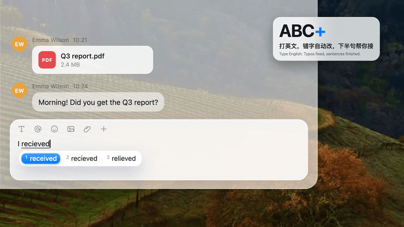

# ABC+



**ABC+ is an English input method for Macs whose system language is not English. It fixes your typos as you type and finishes your sentence.**
It runs a small language model on your own Mac (llama.cpp, Qwen). Nothing you type leaves the machine.

Think of it as the built-in “ABC” English input source with three things added: a Pinyin-style word list, spelling correction that always uses the English dictionary, and ghost-text completion. (The repository is `ABC-Plus`, because GitHub names cannot contain `+`.)

**中文简介：** ABC+ 是 macOS 上的英文输入法，为在非英语地区使用 Mac 的人而做。打英文时，错词按空格就自动改对（`recieve` → `receive`，`teh` → `the`，`i` → `I`），打到一半的词有候选框，还会用灰字帮你接下半句，按 Tab 收下。模型跑在你自己的 Mac 上，只监听本机，不联网，不需要任何系统权限。

## Why

A Mac picks its spelling dictionary from the language list in System Settings. In our tests, with Chinese first in that list, the system spell checker let `teh`, `dont`, `im` and `wich` through as correct words. Many apps (browsers, chat clients) do not correct anything on their own either. ABC+ always checks against the English dictionary, in every app.

## How ABC+ differs from the built-in ABC

| | Built-in ABC | ABC+ |
| --- | --- | --- |
| Spelling dictionary | Follows the system language list. With Chinese first, `teh`, `dont`, `im` and `wich` were treated as correct in our tests | Always English |
| Typing flow | Letters go straight into the app | Each word is underlined with up to 5 numbered choices, like Pinyin |
| Permissions | None | None (same marked-text mechanism as system input methods) |

ABC+ also adds grey ghost text from a local model (Tab to accept), which is not part of this comparison.

The spelling-dictionary row comes from our own test on macOS 27 with Chinese first in the system language list, typing English with the built-in ABC input source. We have not compared other system languages in real apps.

## Features

- **Typos fixed on Space.** `recieve` becomes `receive`, `teh` becomes `the`, `dont` becomes `Don’t`. Press Backspace right after a fix to get your original spelling back.
- **Word list.** Every word you type is underlined and shows up to 5 choices below it, like the system Pinyin input method. Pick one with the number keys.
- **Ghost text.** A local model suggests the next few words in grey. Tab takes one word, Shift+Tab takes the rest.
- **English formatting.** Capital letters at sentence starts, the word “I”, smart quotes and double-space periods. Each follows the matching macOS setting (System Settings › Keyboard › Text Input).
- **Keeps your jargon.** About 220 tech, crypto and chat abbreviations (`gpt`, `btc`, `nft`, `defi`, …) are left alone. Press Esc once to keep any word as typed. Type a word twice and it is remembered.
- **No permissions needed.** It uses the same marked-text mechanism as the system input methods, so it works in apps that do not let anyone read or rewrite their text.
- **Local only.** The model runs on `127.0.0.1` behind an API key generated on your machine.

## Keys

| Key | What it does |
| --- | --- |
| `1`–`5` | Pick a word from the list (shown once a word has 2+ letters) |
| Space | Commit the highlighted word, then a space |
| Return | Commit the word and send |
| Shift+Return | Commit the word and start a new line |
| Esc | Keep the word as typed, and remember it |
| Backspace | Edit the word. Right after a fix, brings back what you typed |
| Option+Backspace | Delete the whole word |
| ← / → | Move the highlight in the list |
| Tab / Shift+Tab | Accept one word / the rest of the grey suggestion |

Text that contains `@ / : _ - #` (usernames, URLs, e-mail addresses) is passed through untouched. To type `web3`, type `web`, press Esc, then `3`.

## Requirements

- macOS 14 or later, Apple Silicon
- [Homebrew](https://brew.sh), to install `llama.cpp` (the installer offers to install both if they are missing)
- Only for building from source: Xcode Command Line Tools (`xcode-select --install`)

## Install

### One click (no compiler needed)

1. Download `ABC-Plus-<version>-macos-arm64.zip` from the [latest release](https://github.com/lyx-27/ABC-Plus/releases/latest) and unzip it.
2. Double-click **Install ABC+.command**. It opens in Terminal, installs the app, downloads the default model (1.56 GB) and starts the local server.
3. If macOS says it cannot verify the file, open System Settings › Privacy & Security, scroll down and click **Open Anyway**, then double-click it again. The app is not notarized by Apple.

To remove it, double-click **Uninstall ABC+.command**.

### From source

```sh
git clone https://github.com/lyx-27/ABC-Plus.git
cd ABC-Plus
./install.sh            # default model, 1.56 GB
./install.sh light      # smaller and faster, 0.63 GB
./install.sh quality    # bigger, 2.71 GB
./install.sh --check    # only check the prerequisites, change nothing
```

The script builds the app, registers the input method, downloads the model (checked against its SHA-256) and starts the local server at login. `scripts/package.sh` builds the release zip.

Then switch to **ABC+** in the input menu (or Ctrl+Space / the Globe key). If it is not listed: System Settings › Keyboard › Input Sources › Edit › **+** › English › **ABC+**.

There is no key to fill in. The API key for the local server is created during install (`openssl rand`) and stored in `~/Library/Application Support/ABCPlus/api_key`.

### Models

Models are downloaded at install time and are not part of this repository. They are quantised GGUF builds of Qwen3.5 base models from [mradermacher](https://huggingface.co/mradermacher). The download goes through `hf-mirror.com` by default; run `HF_ENDPOINT=https://huggingface.co ./install.sh` to use Hugging Face directly. Check each model’s page for its license.

| Preset | Model | Size |
| --- | --- | --- |
| `light` | Qwen3.5-0.8B-Base (Q6_K) | 0.63 GB |
| `default` | Qwen3.5-2B-Base (Q6_K) | 1.56 GB |
| `quality` | Qwen3.5-4B-Base (Q4_K_M) | 2.71 GB |

### Uninstall

```sh
./uninstall.sh           # keeps models, settings and learned words
./uninstall.sh --purge   # also deletes ~/Library/Application Support/ABCPlus and the logs
```

## Settings

Edit `~/Library/Application Support/ABCPlus/config.json`. Missing keys fall back to the defaults in [`config.default.json`](config.default.json). Useful ones:

| Key | Default | Meaning |
| --- | --- | --- |
| `llmEnabled` | `true` | Ghost-text suggestions from the model |
| `maxWords` | `6` | Longest suggestion, in words |
| `candidateCount` | `5` | Words in the list |
| `autocorrect` | `null` | `null` follows macOS “Correct spelling automatically” |
| `blockedApps` | terminals, VS Code, Xcode, … | Bundle IDs where ABC+ stays out of the way, because Tab means something else there |
| `debug` | `false` | Logs prompts and suggestions. Leave it off: it records what you type |

## Privacy

- The model server listens on `127.0.0.1` only and requires the API key.
- The words ABC+ learns are kept in `~/Library/Application Support/ABCPlus/memory.json` on your machine.
- The only network traffic is the one-time model download.

## Known limits

- Another tool that also grabs Tab (Cotypist, for example) will fight with it for the key.
- Terminals and code editors are blocked by default (see `blockedApps`).
- The model is small. Suggestions are a convenience, not an authority.

## Development

```sh
scripts/build.sh                     # builds build/ABCPlus.app
scripts/logic_test.sh                # typing-logic checks, no GUI or model needed
scripts/server.sh status             # check the local model server
```

`scripts/e2e_test.swift` types into a real app and checks the result. `scripts/bench.py` measures generation speed.

## FAQ

**Who is this for?**
People who type English on a Mac whose system language is not English, for example Chinese. If your Mac is already set to English you probably do not need it.

**Does it send what I type anywhere?**
No. The model server listens on `127.0.0.1` only and needs the API key created on your machine. The only download is the model, once, at install.

**Does it need Accessibility or Input Monitoring permission?**
No. It is a regular input method that uses marked text, so macOS does not ask for either.

**Which apps does it work in?**
It has been used in Chrome (web pages, chat boxes and forms), WeChat, Lark, Word, a LaTeX editor, WhatsApp Web and Instagram Web. Terminals and code editors are blocked by default because Tab means something else there. See `blockedApps` in the settings.

**Does it run on Intel Macs?**
No. The build targets Apple Silicon and macOS 14 or later.

**How big is the model, and how fast is it?**
0.63 GB (`light`), 1.56 GB (`default`) or 2.71 GB (`quality`). The default model generated about 67 tokens per second on an M5 in our tests.

**Why is it called ABC+?**
The built-in English input source is called ABC. This one adds the things it lacks. The repository is `ABC-Plus` because GitHub does not allow `+` in names.

**Can I stop it from correcting a word?**
Press Esc once and it keeps your spelling and remembers it. Type a word twice and it is left alone from then on.

## License

[MIT](LICENSE) © 777-27. The language models are downloaded separately and have their own licenses.
